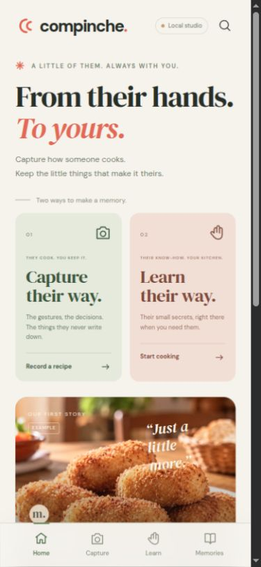
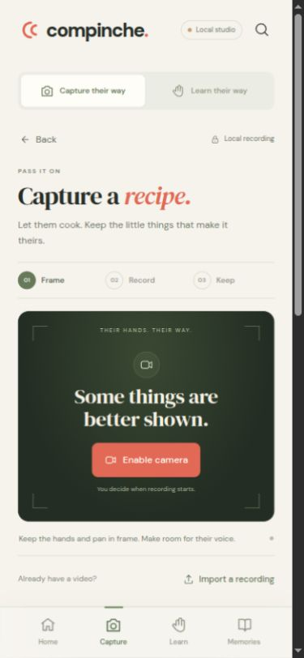
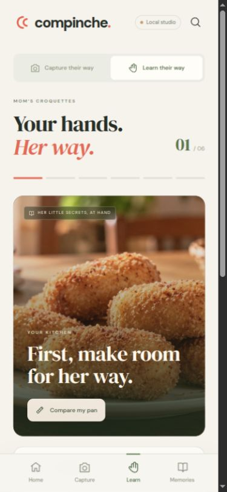
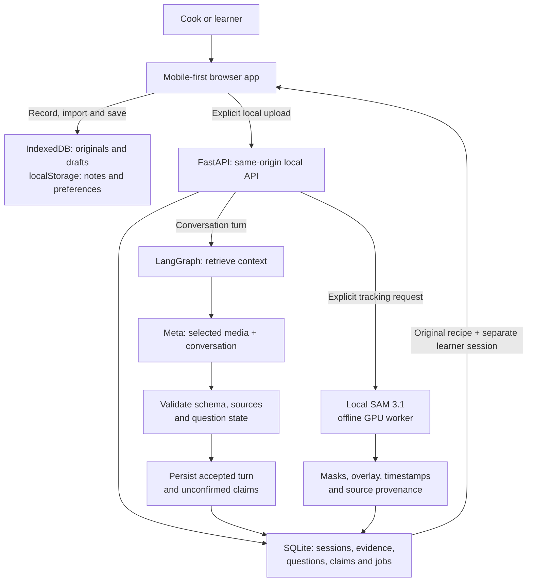
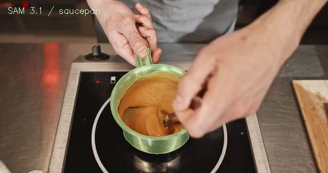

# Compinche

### From their hands to yours.

**Capture how someone cooks. Keep the little things that make it theirs. Learn to do it in your own kitchen.**

Recipes leave things unsaid. “A little more.” “Until it feels right.” “Like this.” Compinche is an attentive apprentice for that knowledge: the gesture, the signal a cook notices, the reason behind a decision, and the explanation that makes it repeatable.

Compinche learns during a continuous camera-and-voice session, using a phone or the native Ray-Ban Meta SDK host. The family recording also supplies a causal replay for testing the same loop. The original stays in ignored local storage. A clearly labelled **Mom’s croquettes** example remains available when no family recording has been prepared.

**Hackathon prototype · Spanish live conversation / English library · Mobile first · FastAPI + LangGraph · Meta Model API · Local SAM 3.1**

[Run locally](#run-locally) · [Try the demo](#a-three-minute-demo) · [Architecture](#how-it-works) · [What is working](#what-is-working) · [SAM evidence](#real-sam-output)

<table>
  <tr>
    <td align="center"><strong>Choose your experience</strong></td>
    <td align="center"><strong>Capture a recipe</strong></td>
    <td align="center"><strong>Learn a recipe</strong></td>
  </tr>
  <tr>
    <td></td>
    <td></td>
    <td></td>
  </tr>
</table>

## Run the family demo

Prepare your own recording locally from `application/` (stop the demo server before preparing its data directory):

```sh
backend/.venv/bin/python -m backend.family_demo "/path/to/family-recording.mp4" \
  --data-dir backend/.data/family-demo --env-file backend/.env.local --live
npm run demo
```

Open [http://127.0.0.1:8017](http://127.0.0.1:8017). `--live` explicitly sends prepared clips/audio to Meta; omit it to prepare local media without inference. The credential file is local and ignored. This command preserves the original, makes bounded working clips and a HEVC SDK replay, caches accepted analysis, and leaves every transcript and generated discovery unconfirmed. Family videos and posters are not bundled into this repository.

The agent remains **`muse-spark-1.3`**. Dedicated speech transcription uses **`muse-voice-transcribe-1.0`** because Meta documents degraded audio support in Spark 1.3. The current family recording returned no speech turns from the speech model; no dialogue was invented. [Meta audio documentation](https://dev.meta.ai/docs/video-understanding) and [speech transcription protocol](https://dev.meta.ai/docs/speech-to-text).

The browser live view supports the phone camera and causal replay. The [Android MockDeviceKit host](wearables/android/README.md) supplies the native SDK path without physical glasses: actual SDK preview frames, PCM24k speech, spoken questions and automatic preservation of the SDK recording. The APK builds successfully; execution on a phone remains pending.

## Learn while the cook works

Open [the continuous session](http://127.0.0.1:8017/#teach). Choose the causal replay of the original recording or the phone camera, declare who will actually answer, and start one consented session. Compinche observes incoming images, listens continuously, asks one useful question aloud, and waits for the person's explanation. The live interface is in Spanish.

A microphone reply is attributed to the declared speaker, with the question, captured frames and time interval attached. It creates an **unconfirmed** decision card. Reviewing that card is a separate human action. Recorded source audio provides context and cannot impersonate a new answer. A learner session can use only confirmed lesson knowledge.

Vision, speech recognition, local speech output and SAM have independent queues. Spark receives at most two ordered inline JPEGs per window; it does not upload a new video file for each visual turn. The optional SAM tool keeps its weights resident between jobs and never blocks capture or speech. The complete original recording is preserved separately.

The [continuous-flow implementation and measured limits](docs/LIVE.md) explain what is implemented and what still needs a human/device test. The original import-and-review screens remain available for reviewing saved sources; `#record` is manual recording without the live companion.

## Built during the hackathon (26 Oct – 4 Nov 2026)

All of this repository was written during the event; the commit history is the record. Highlights, newest first:

| Date | What was built |
| --- | --- |
| 2 Nov | Learner questions answered by **Muse Glimmer** on the local GPU (vLLM), Spark fallback · corrections to cards · card categories · sharper questions · live segmentation through **SAM 3.1 on the Meta Model API** |
| 1 Nov | Live timeline of phases and heat changes · gesture comparison with **CoTracker3** + DTW + Spark · vessel measurement with **SAM 3.1** + **MapAnything** and a top-view request · learner mode with proactive reminders · reply relevance check |
| 31 Oct | Continuous live session: camera/replay, Muse Voice Transcribe streaming, spoken questions, decision cards, Android Meta SDK host |
| 29 Oct | Mobile app, capture/import, LangGraph agent, Meta adapters, local SAM 3.1 |

Scene-by-scene map of the demo video to the working features: [docs/GUION.md](docs/GUION.md).

## What is working

| Experience | Current status |
| --- | --- |
| English mobile interface | Implemented, with distinct Capture and Learn routes, bottom navigation, local fonts and responsive layouts. |
| Camera and import | Browser camera/microphone recording, pause/resume, imported clips, timestamped notes, saved recordings, drafts and downloads. Requires browser permission and a supported secure context. |
| Personal memory | Saved discoveries, notes, progress, search and JSON export. Video files are downloaded separately. |
| Local application | FastAPI serves the interface and API; SQLite stores sessions, evidence, questions, claims and jobs. |
| Conversational agent | Real LangGraph workflow with persistent checkpoints, explicit question/answer state and source validation. |
| Meta integration | Server adapter for the Meta Files and Responses APIs. Live Meta turns were verified in the recorded croquettes experiment and in the locally prepared family demo. Runtime health separately reports whether the current server has made a successful call. Without a key the app shows the missing connection. |
| SAM 3.1 | Real local segmentation adapter, exercised on a stock clip. The included output is a recorded test; new jobs require a separately configured compatible GPU runtime. |
| Example recipe | Scripted, clearly labelled demonstration using illustrative media. Its questions and discoveries are not presented as live model findings. |

## Run locally

Use **Python 3.12** and a modern browser. Node.js 18+ is needed only for the npm convenience commands and JavaScript checks. There is no frontend build step and no npm package installation.

On Linux or macOS:

```bash
git clone https://github.com/DavidDiazMerino/compinche.git
cd compinche
python3 -m venv backend/.venv
backend/.venv/bin/python -m pip install -r backend/requirements.lock.txt
npm start
```

Open **[http://127.0.0.1:8000](http://127.0.0.1:8000)**. The same server serves the application and its API. Interactive API documentation is at [/docs](http://127.0.0.1:8000/docs).

Without Node.js, use the equivalent command:

```bash
backend/.venv/bin/python -m uvicorn backend.app:app --host 127.0.0.1 --port 8000
```

On Windows, create the same virtual environment and use `backend\.venv\Scripts\python.exe` in place of `backend/.venv/bin/python` for installation and the direct server command.

**No API key or GPU is needed to explore the example, capture/import a recipe, save notes or create local sessions.** Model features show their actual availability in the app’s connection screen and at `/api/health`.

### Connect Meta

Obtain an API key through the [Meta Model API](https://dev.meta.ai/docs/overview). Supply `MODEL_API_KEY` or `META_API_KEY` in the **server environment**, then restart the application. Keep the key out of browser code, Git and screenshots. The server does not automatically load `.env` files; [backend/.env.example](backend/.env.example) documents the supported names.

For a temporary Bash session, this reads the key without displaying it or putting its value in command history:

```bash
read -r -s -p "Meta API key: " MODEL_API_KEY
export MODEL_API_KEY
npm start
```

The default model is `muse-spark-1.3`, configurable with `COMPINCHE_META_MODEL`. The adapter uses `https://api.meta.ai/v1`, selected media uploads and structured JSON output. Its request format follows Meta’s [video understanding](https://dev.meta.ai/docs/video-understanding) and [Responses API](https://dev.meta.ai/docs/protocols/responses) documentation. A configured key becomes a live-verified connection only after a successful response.

### Enable local SAM

SAM is optional and separate from the Python web-server installation. It requires Docker with GPU access, FFmpeg, a compatible runtime image and authorized local SAM model weights. Checkpoints are not included in this repository and are not downloaded automatically.

Configure `COMPINCHE_SAM_IMAGE`, `COMPINCHE_SAM_CACHE` and `COMPINCHE_GPU_LOCK` for your machine. The current adapter was validated on a GB10 host and uses conservative memory guards: at least 42 GiB available to start, stopping below 20 GiB. This is not a claim that the same setup runs on every laptop or GPU.

See [the SAM runtime guide](backend/SAM.md) for configuration, output contracts and limits. An optional [Docker build recipe](backend/Dockerfile.sam) is included but has not been built or validated; the recorded test used an existing compatible runtime. The official [SAM 3 repository](https://github.com/facebookresearch/sam3) and [SAM 3.1 release notes](https://github.com/facebookresearch/sam3/blob/main/RELEASE_SAM3p1.md) cover model access and upstream setup.

## A three-minute demo

| Time | Show | Story to tell |
| --- | --- | --- |
| 0:00–0:25 | Home → Capture / Learn | “Some things are written in a recipe. Some things live in the person making it.” |
| 0:25–1:00 | Capture a short clip or import one; add a note; save | Keep the cook’s original demonstration and the details you noticed. Camera access begins with an explicit action. |
| 1:00–1:40 | Open the local agent; select evidence; observe and answer | With a configured Meta key, show a complete observation → question → answer exchange and human confirmation. Without a key, use the labelled example and explain that the connection is not enabled. |
| 1:40–2:05 | Track an object or show the included SAM test | A real mask follows a saucepan. Explain which result is pre-recorded and which request is running now. |
| 2:05–2:40 | Learn from the recipe; add an attempt; compare | A new cook has a separate session with the original lesson available. The manual pan comparison uses entered diameters. |
| 2:40–3:00 | Memories and original evidence | End with the person behind the knowledge: “I wanted to learn to cook like her.” |

Use a short, consented demonstration for a live capture. The packaged cooking montage is stock footage; the app labels it as an example. Live inference time is variable, so keep the recorded SAM evidence available for the presentation.

## How it works



The agent follows four explicit steps: **retrieve → reason → validate → remember**. Each session has a persistent LangGraph checkpoint and application records in SQLite. Learning sessions reference the source recipe without merging teacher and learner messages. See the [backend guide](backend/README.md) for API contracts and the [LangGraph persistence documentation](https://docs.langchain.com/oss/python/langgraph/persistence) for the underlying checkpoint model.

Every candidate discovery distinguishes **observed**, **said** and **inferred** information. Source IDs stay attached. Deterministic checks reject unknown evidence, unsupported common physical quantities, invented quotations and some unsupported visual or food-safety claims. A pending question has explicit state; the person’s answer can close it. Only a human can confirm a discovery. These checks constrain the model; they do not prove that every generated interpretation is correct.

SAM provides a different kind of evidence: object masks, pixel coordinates and tracking across frames. It does not establish weight, physical dimensions, temperature, tactile resistance or doneness.

## Real SAM output

[](dist/assets/sam-test-overlay.mp4)

[Watch the recorded overlay](dist/assets/sam-test-overlay.mp4) · [Inspect the JSON report](dist/assets/sam-test-result.json)

A fresh local integration test on **29 October 2026** processed a two-second stock clip at four frames per second and returned saucepan masks in eight frames. Total execution was **23.615 seconds**, including **11.656 seconds** loading the model. These are one test’s measurements, not an accuracy benchmark or a real-time performance claim.

The public sample includes the overlay, poster and report; individual mask files remain in the local test artifacts. New jobs analyze at most the **first eight seconds**, at **4 fps**, up to **640 px** wide and **32 frames**. See [SAM.md](backend/SAM.md) for the full evidence record.

## Data, privacy and current limits

| Action | Where data goes |
| --- | --- |
| Record, import, save a draft or personal note | This browser’s storage. Nothing is uploaded by recording alone. |
| Open a recording with the local agent | A working copy is saved under the local server’s data directory. |
| Send a conversation turn | Bounded conversation context is sent to Meta when the connection is configured. |
| Ask Meta to observe selected media | Those selected files are uploaded to Meta along with context. Provider processing and retention terms apply. |
| Run SAM tracking | The local runtime processes server-owned media; the model worker has no network access. |

Server data defaults to `backend/.data/`; `COMPINCHE_DATA_DIR` can change it. Browser storage and server storage are separate. Keep video downloads or backups you control: browser storage can be cleared, and abruptly closing a browser during recording can lose an unfinished take.

The conversational and visual Meta adapter requests `store:false`. That is not a promise of immediate deletion of uploaded Files objects; the current adapter does not delete remote files. LangSmith tracing is disabled to avoid inheriting a tracing configuration that would export conversations.

This is a **local development application**. Keep it bound to `127.0.0.1`; it has no account system, multi-user authorization or public deployment configuration. Origin and Host checks are additional boundaries, not authentication. The responsive interface can be inspected in browser mobile emulation. Using the camera on a separate phone would need a deliberately configured HTTPS and authenticated deployment; this release does not expose one.

Current boundaries:

- Uploads are limited to **150 MiB**; interactive Meta attachments to **40 MiB** each. Supported media types and browser playback still matter.
- The live loop (camera → Spark → spoken question → answer → card) is verified on the replayed family recording and with typed answers; a complete microphone session with the cook is still to be recorded.
- Vessel diameter is an estimate with a range: monocular metric depth varies frame to frame and a known reference must be visible. On the family recording the pot measured 27–33 cm across views; its real size has not yet been checked.
- Gesture comparison names one visible difference between aligned frames. It does not judge doneness, texture or temperature.
- Ingredient weights, thermal modelling and reliable doneness evaluation are not attempted.
- Example questions and discoveries are authored from the story script. A real family teaching session and an independent learner evaluation are still needed to validate the broader product idea.

## Development

```bash
npm run check
npm test
```

**Release validation:** backend and client regression suites cover provenance windows, heuristics, recoverable sends, source inspection, corrections, local clips and real-memory search. See the implementation review for the latest verified counts. The browser flow was also exercised from stock-video import through notes, a fresh SAM job and a linked learning session; the second real segmentation run completed in 24.418 seconds with detections in eight of eight sampled frames. Mobile layouts were checked at 320 and 390 CSS-pixel viewport settings. Phone camera hardware remains unverified. Recorded Meta calls and the family video were exercised separately; Android SDK compilation is distinct from device/emulator execution.

`check` validates the frontend JavaScript modules. `test` runs the backend tests with the project’s Python environment. Tests cover session persistence, conversation continuity, question state, evidence boundaries, confirmations, API behavior and SAM runtime guards. Meta transport is mocked in tests; that is separate from a live provider verification. [GitHub Actions](.github/workflows/ci.yml) runs the JavaScript and backend checks without API keys or GPU inference.

```text
dist/                    Browser application; no build step
  app.js                 Routes, interaction and session UI
  capture.js             Camera, imports, drafts and IndexedDB
  api.js                 Client for the local backend
  assets/                Illustrative media, fonts and SAM sample
backend/
  app.py                 FastAPI routes and local server
  agent.py               LangGraph workflow and validation
  provider.py            Meta Model API adapter
  store.py               Durable application records
  sam_service.py         Bounded local segmentation jobs
  sam_worker.py          Isolated SAM inference worker
  tests/                 API, state and integration-boundary tests
docs/screenshots/        Screenshots of the actual interface
```

The next useful experiments are a consented end-to-end teaching session, a learner repeating an unfamiliar gesture, measured tests of adaptations to another pan, and a live Meta evaluation across varied cooking footage. Each should retain inputs, questions, corrections and failure cases.

## Credits and license

Application code is released under the [MIT License](LICENSE). Third-party assets and model weights retain their own terms; they are not relicensed by the application license.

Cooking footage comes from **Pressmaster**, **Taryn Elliott** and **cottonbro studio** on Pexels. The cover image is AI-generated and illustrative. Asset-level sources are recorded in [credits.json](dist/assets/credits.json). DM Sans and DM Serif Display are bundled with their respective [font license](dist/assets/DM-Sans-LICENSE.txt) [files](dist/assets/DM-Serif-Display-LICENSE.txt).

Built with [FastAPI](https://fastapi.tiangolo.com/), [LangGraph](https://docs.langchain.com/oss/python/langgraph/overview), the [Meta Model API](https://dev.meta.ai/docs/overview), and [Segment Anything](https://github.com/facebookresearch/sam3). This independent hackathon project does not imply endorsement by these projects or by the people shown in the stock footage.
