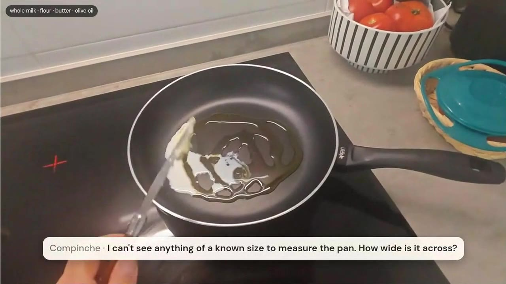
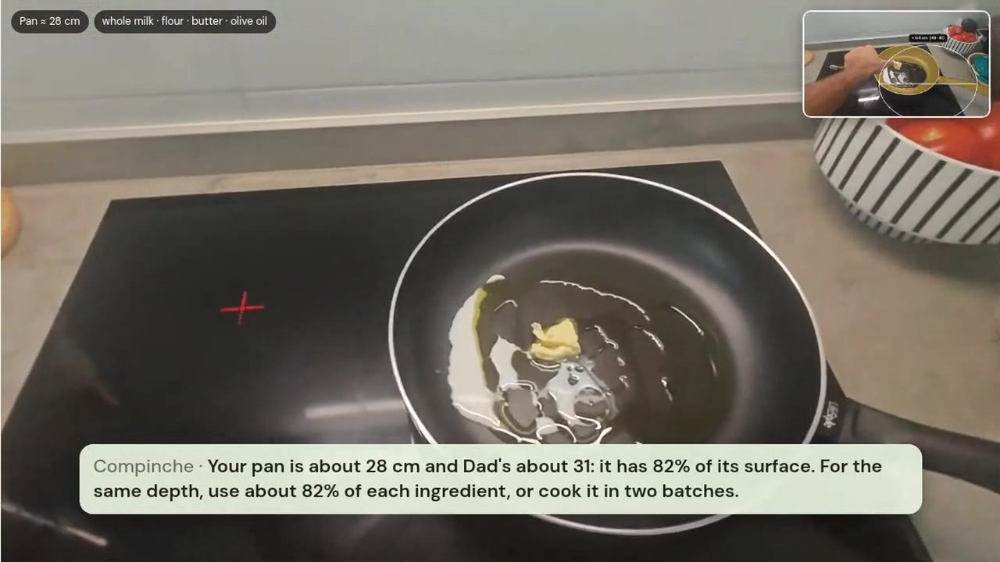
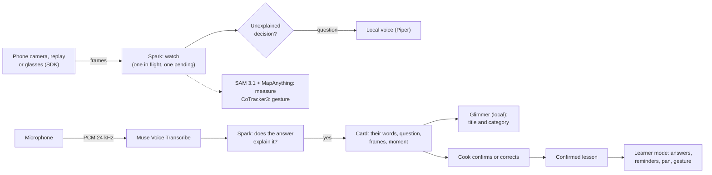
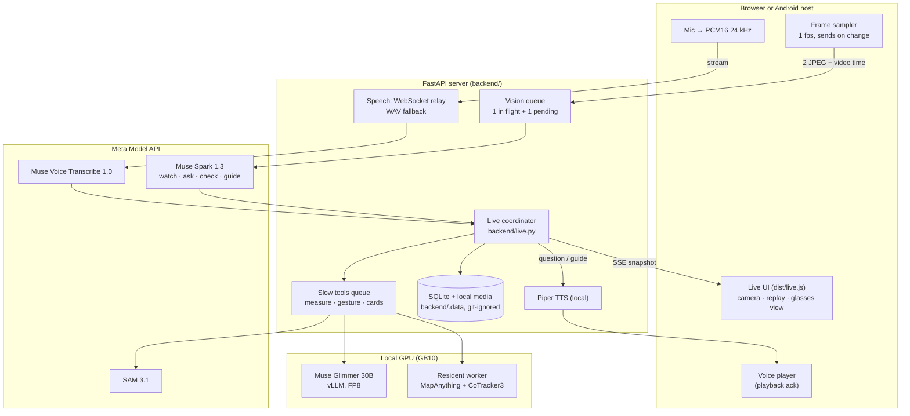
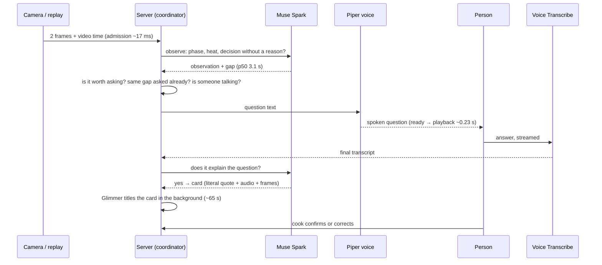
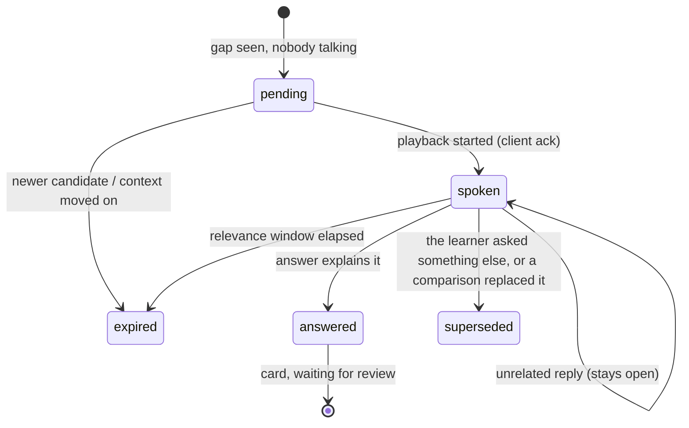

# Compinche

### From their hands to yours.

**An apprentice that watches someone cook, asks about what they didn't explain, and teaches it back to you in your own kitchen.**

Recipes leave things unsaid: “a little more”, “until it looks right”, “like that”. The knowledge is in the person: what they look at, why they turn the heat down, how they know it's ready.

Compinche watches a cook through a phone camera (or Ray-Ban Meta glasses through the Wearables SDK). When the cook makes a decision without saying why, it asks, out loud, at that moment. The cook's own words are kept as a card, tied to the question and to the moment in the video. The cook confirms or corrects the card. Later, when someone else makes the dish in another kitchen, Compinche brings that teaching back, and only that.

The demo is personal: my dad teaching me his béchamel for croquettes.

<table>
  <tr>
    <td></td>
    <td></td>
  </tr>
  <tr>
    <td align="center">Learner mode: no reference of known size is visible, so Compinche asks.</td>
    <td align="center">It compares the learner's pan with the pot from the lesson.</td>
  </tr>
</table>

*Built during the Meta AI Developer Hackathon (26 Oct – 4 Nov 2026), Indie track.*

[The loop](#the-loop) · [What works today](#what-works-today) · [Meta models](#meta-models) · [Run it](#run-it) · [Architecture](#architecture) · [Latency](#latency-what-we-measured) · [Error recovery](#error-recovery) · [Another recipe](#tried-on-another-recipe) · [The demo video: live vs edited](#the-demo-video-what-is-live-and-what-is-edited) · [Limits](#limits)

## The loop

1. **Watch.** Muse Spark looks at the latest frames while the person cooks. It follows the phases of the recipe and the heat.
2. **Ask.** When it sees a decision whose reason is missing (lowering the heat, lifting the whisk to look, covering the bowl), it asks one short question aloud and waits for a natural pause.
3. **Keep their words.** The spoken answer is transcribed by Muse Voice Transcribe. Spark checks whether it explains the question: an unrelated reply keeps the question open, and a fragmented answer is joined first. The card keeps the speaker, the question, the frames and the moment in the video. The literal words are never rewritten.
4. **Review.** The cook confirms the card, or corrects it in their own words. A correction replaces whatever had been derived from the earlier words. Muse Glimmer, running locally (Spark if it is not running), turns each explanation into a titled card in the background.
5. **Teach it back.** In learner mode, Compinche uses **only confirmed cards**:
   - It answers questions by quoting the teacher, and says so when something was not taught.
   - It gives one proactive reminder when the learner reaches the right moment.
   - It measures the learner's pan and compares it with the one in the lesson.
   - It compares the learner's gesture with the teacher's demonstration.

## What works today

Status on 4 November 2026. Every Compinche line in the demo video was generated by the app; see [what is live and what is edited](#the-demo-video-what-is-live-and-what-is-edited).

| Part | Status |
| --- | --- |
| Live teaching session | Phone camera (Chrome) or causal replay of a recording; continuous listening; spoken questions with a local voice. Tested on 3 Nov with a person cooking live on the phone and answering by microphone. On Dad's 16-minute recording it asked 12 questions. |
| Dad's teaching | Done. Dad answered four of those questions (ingredients, when to lower the heat, how he knows the batter is ready, why the film touches the béchamel). His answers are attached to the questions, and he confirmed them: they are the lesson's four cards. |
| Review | Confirming and correcting cards; corrections re-derive the card; cards that are still being consolidated finish after the session ends. |
| Lesson page | Recipe, the cook's confirmed cards with their quote, their voice note, an English translation, and the timeline of the session. |
| Learner mode | Tested on 4 Nov on my own recording in my kitchen, with Dad's four cards. Compinche answered “The milk was cold?” by quoting Dad (hot milk). It reminded me to lower the heat before I did. It also invited me to repeat the whisk test and compared my gesture with his. It answers only from confirmed cards and says when something was not taught. |
| Measuring the vessel | SAM 3.1 finds the pot and a 1 L milk carton used as a scale reference, and MapAnything gives the geometry. Dad's pot: about 29–31 cm, from a steep side view, so the range is wide. Its real diameter has not been checked. If no reference is visible, it asks the size (my pan: 28 cm, measured at 27.9 cm with the carton). It then compares surfaces: 82%. |
| Gesture comparison | CoTracker3 + DTW align two gestures; Spark names one visible difference; split-screen video. Dad's whisk lift vs mine: “You keep your whisk down in the pan while he lifts his high…”. |
| Muse Glimmer (local) | Turns explanations into titled cards in the background on a GB10 (FP8, ~7.5 tokens/s, ~65 s per card). Can also answer the learner (`COMPINCHE_GLIMMER_GUIDE=1`, ~35 s); Spark does it live by default. |
| Languages | Spanish and English sessions; the teacher can speak Spanish while the learner works in English. |
| Other recipes | Tried on a Spanish omelette video with the same prompts: see [Tried on another recipe](#tried-on-another-recipe). |
| Ray-Ban Meta / Android | A native host built on the Wearables SDK with MockDeviceKit; the APK builds. Not yet run on a phone with glasses. |

The video script, taken from the edit and from the takes recorded with the app, is in [docs/GUION.md](docs/GUION.md) (Spanish). Measured latencies and earlier trials are in [docs/LIVE.md](docs/LIVE.md).

## Meta models

| Model | What it does in Compinche | Where it runs |
| --- | --- | --- |
| **Muse Spark 1.3** | Watches and asks, checks whether an answer explains the question, guides the learner, compares gestures | Meta Model API |
| **Muse Voice Transcribe 1.0** | Continuous speech recognition, biased with the recipe's vocabulary | Meta Model API (WebSocket) |
| **SAM 3.1** | Segments the vessel, the scale reference and the tool in use | Meta Model API |
| **Muse Glimmer 30B** | Turns explanations into cards in the background; optionally answers the learner | Local GPU (vLLM, FP8), Spark as fallback |
| **MapAnything** (Apache-2.0) | Metric geometry for measuring | Local GPU |
| **CoTracker3** | Point tracking to align gestures | Local GPU |

## Run it

Use **Python 3.12** and a recent Chrome. Node.js 18+ is only needed for the npm shortcuts. There is no frontend build step.

```bash
git clone https://github.com/DavidDiazMerino/compinche.git
cd compinche
python3 -m venv backend/.venv
backend/.venv/bin/python -m pip install -r backend/requirements.lock.txt
cp backend/.env.example backend/.env.local     # add MODEL_API_KEY
backend/.venv/bin/python -m backend.serve --env-file backend/.env.local --port 8017
```

Open **[http://127.0.0.1:8017/#teach](http://127.0.0.1:8017/#teach)**:

- **Teach:** choose the phone camera or a recording, say who is cooking, and start. Compinche watches, listens and asks. The **Glasses view** button gives a clean frame for filming.
- **Learn:** choose a lesson; only its confirmed cards are used.

Optional parts:

- **Muse Glimmer:** run `backend/glimmer/serve.sh`, then start the server with `COMPINCHE_GLIMMER_URL=http://127.0.0.1:8100/v1`.
- **Measurement and gestures:** need a local GPU runtime; see [backend/MEASURE.md](backend/MEASURE.md).
- **Local voice:** Piper; see [docs/LIVE.md](docs/LIVE.md#instalación-y-api). Without it, the browser voice is used.

**Phone camera:** browsers only allow the camera on HTTPS or `localhost`.

- Over USB: `adb reverse tcp:8017 tcp:8017` and open `http://localhost:8017/#teach` on the phone.
- From another house: put it behind Tailscale with `tailscale serve`, and add the host name to `COMPINCHE_ALLOWED_HOSTS`. The app has no accounts, so anyone in that tailnet can open it.

**Keys:** the Meta key stays in the server environment (`MODEL_API_KEY`), never in the browser. `backend.serve --env-file` loads a local file that Git ignores.

## How it works



Vision, speech, voice and the slow tools (measurement, gestures, card consolidation) run in separate queues, so a slow tool never delays a question. Vision keeps one observation in flight and one replaceable pending one, rather than queueing every late frame. Seeking, pausing or stopping invalidates stale results, and late questions say which moment they refer to. Recorded audio from a replay is context only: it can never answer a question in someone's name.

Each card separates what was **said** (the literal quote, with its audio) from what was **derived** (signal, decision, title). Only a person can confirm it.

The learner never sees unconfirmed cards. A learner answer marked as known must cite a confirmed card. Quantities that are not in the lesson are refused rather than made up.

Code: [backend/live.py](backend/live.py) (session coordinator), [backend/live_provider.py](backend/live_provider.py) (prompts and Meta adapters), [backend/measure.py](backend/measure.py), [backend/gesture.py](backend/gesture.py), [dist/live.js](dist/live.js) (live interface).

## Architecture

### Components



Each kind of work has its own queue, so a slow tool never delays a question. Vision keeps one call in flight and one replaceable pending window: when the model is slow, it skips stale frames rather than falling behind. Everything carries the **video time** of the frames it came from, so a late answer still points at the right moment.

### One question, end to end



### Question lifecycle



Guides in learner mode follow the same path, with one more rule: each confirmed card is used for at most one reminder.

### The two journeys

```mermaid
journey
    title Teaching (Dad) and learning (me)
    section Teacher cooks
      Cooks as usual, phone or glasses watching: 5: Teacher
      Hears a short question at a natural pause: 4: Teacher
      Answers in their own words: 5: Teacher
      Confirms or corrects the card with their name: 4: Teacher
    section Learner cooks
      Picks the lesson, cooks in their own kitchen: 5: Learner
      Asks out loud; gets the teacher's words back: 5: Learner
      Gets a reminder just before the step: 4: Learner
      Repeats the gesture; sees it next to the teacher's: 4: Learner
```

## Latency: what we measured

From the stored sessions, not from the video. *Teach* is Dad's 16-minute recording in causal replay (3 Nov, 145 frame windows, 12 questions). *Learn* is my own recording in learner mode (4 Nov, 96 windows, 7 guides).

| Step | Teach p50 / p90 | Learn p50 / p90 |
| --- | --- | --- |
| Frames admitted by the server | 17 / 21 ms | 8 ms |
| Waiting in the vision queue | 6 ms / 0.84 s | 1.8 / 3.5 s |
| Muse Spark observation (`minimal` effort, 2 frames) | 3.1 / 5.6 s | 4.3 / 5.6 s |
| Observation → question or guide ready | 15 ms (same call) | 2.4 / 3.1 s (second Spark call that writes the guide from the card) |
| Frames received → question ready | **7.3 / 9.7 s** | **7.7 / 8.7 s** |
| Question ready → voice playing (client ack) | 0.23 / 0.29 s | 0.29 / 0.38 s |
| Speech: streamed transcript | real time (WebSocket) | real time |
| Speech: WAV fallback per utterance | — | 2.6 s |
| SAM 3.1 (Meta API) + MapAnything (warm) | 0.8–1.4 s + 0.2–1.6 s | 1.1–8.6 s for the whole measurement |
| CoTracker3 per 10 s clip (warm) | — | 2.9–8.9 s |
| Glimmer card in the background | ~65 s | — |

Read it like this: a question is spoken about **7–10 s after the frames that triggered it**, plus the capture interval (frames are sampled every second and sent when the scene changes, at least 4 s apart). That is fast enough for slow decisions (the heat, the texture of the batter), which last for minutes. It is too slow for a two-second gesture, so questions about a gesture are phrased about what just happened (“When you lifted the whisk just now…”). The wait is also partly deliberate: Compinche never talks over the cook, and it holds a question until there is a pause.

On the omelette video the same Spark call took 2.6 / 3.8 s (p50 / p90): shorter scenes, shorter observations.

### How we would make it faster

1. **Send frames on events, not on a timer.** A cheap local motion or hand detector (or the SAM 3.1 masks we already compute) would send the window the moment the tool leaves the pot, rather than at the next interval. That alone removes up to 4 s.
2. **Stream Spark's structured output.** Today we wait for the whole JSON. The question field could be spoken as soon as it is complete and validated, while the rest of the observation finishes.
3. **Split observing from asking.** Run a small, fast “is something happening?” pass on every window and only call the full observation when it fires. Glimmer is too slow for this on our GPU (~7.5 tokens/s); a smaller open model, or Glimmer with speculative decoding, are the candidates we would measure next.
4. **Pre-write the guide.** In learner mode, the second Spark call (2.4 s) could be prepared as soon as the learner enters the phase where a card applies, and only spoken when the moment arrives.
5. **Keep everything warm.** Measurement's slow cases (8.6 s) are a cold worker; the worker is resident now and starts with the session.

Every one of these needs measuring on annotated opportunities (missed, duplicate and late questions too), not only on the questions that worked.

## Error recovery

Compinche is built to say “I don't know” rather than guess:

- **No reference to measure with.** If SAM 3.1 finds the vessel but no object of known size, Compinche asks “How wide is it across?” instead of giving a number. If the view is too steep, it asks for a view from above. A stated size outside 8–80 cm is not accepted, and inches are converted.
- **An answer that doesn't answer.** Spark checks whether the reply explains the question. An unrelated reply leaves the question open; a reply split across several utterances is joined first.
- **Not in the lesson.** A learner answer marked as known must cite a confirmed card. Otherwise Compinche says the teacher didn't explain it. Quantities that are not in the lesson are refused, across languages (“a litre” vs “un litro”).
- **A model call fails.** Vision failures are logged with their cause and the session carries on with the next window. If Glimmer is not running or times out, Spark writes the card.
- **Stale results.** Seeking, pausing or stopping bumps a scene epoch, and results from the old epoch are dropped. A question about a moment that has passed expires instead of being asked late.
- **Gesture clips that are too short.** Below six frames per side, no comparison is made.
- **Recorded voices are never answers.** In a replay, the recording's own audio is context only. It can never answer a question in the recorded person's name.
- **Flame cues on induction.** The flame-based heat reading only runs when a gas flame was seen first, so an induction hob's lights are not read as fire.

## Tried on another recipe

To check that Compinche is not built for croquettes, we ran a **Spanish omelette** video through teach mode with the same code and prompts: [Patata tortilla.webm](https://commons.wikimedia.org/wiki/File:Patata_tortilla.webm) by Elene B, CC BY-SA 4.0, 2:39. The video is not in this repository.

It followed the recipe from the frames alone: peeling and cutting potatoes, potatoes into cold oil, frying, draining onto paper, cracking and beating eggs, mixing, the mixture into the hot pan, the flip, plating. It asked three questions:

| Video | Question |
| --- | --- |
| 0:01 | “I see your golden Spanish omelette ready on the counter. What did you put in it and how much of each?” (mise en place; the video opens on the finished dish) |
| 1:17 | “I can't see anything of a known size to measure the pan. How wide is it across?” |
| 2:37 | “When you tipped it out, how did you know it was ready to come out?” |

Three questions in 2:39 is fewer than on Dad's recording (12 in 16 min, a similar rate, but this video is an edited montage with cuts, so fewer decisions are left unexplained on screen). Nobody answered, so no cards were made. The summary is in [docs/experiments/2026-11-04-other-recipe](docs/experiments/2026-11-04-other-recipe/summary.json).

## The demo video: what is live and what is edited

We would rather say it than have someone find it:

- **Every Compinche line is real output.** The questions, answers, reminders and comparisons in the video were produced by the app in two sessions: Dad's 16-minute recording in causal replay (teach), and my own recording of making béchamel replayed in learner mode with Dad's four cards. Those sessions were run from recordings, not with a live phone in the kitchen; a live phone session was tested separately on 3 Nov.
- **Dad answered afterwards.** He couldn't cook again, so he answered the app's questions by voice notes. The notes were attached to those questions in the app, and the cards were confirmed with his name.
- **Two bubbles were moved in the edit.** The film question (scene 08) appears about 5 s earlier than it did, so that it is on screen while he handles the film. In my kitchen, the heat reminder came about 25 s before I lowered the heat. In the edit it sits right before the gesture.
- **The gesture split screen** was computed after the session, with the app's own `GestureService`, on the moments the app picked. The live trigger was cancelled because my recording ended first.
- **The phone setup** at the start is the real interface, recorded in a phone-sized browser window. The “under the hood” shots are the real SAM 3.1 masks, MapAnything point cloud, CoTracker3 tracks and timeline from these sessions.
- **The pot size** (about 29–31 cm) has not been checked against a tape measure.

## Limits

- **One teacher, one learner, one dish so far.** The full loop (questions, answers, confirmed cards, guidance in another kitchen) has been run end to end once, with Dad and me. The omelette run only covers teach mode without answers.
- **Vessel diameter is an estimate with a range.** It needs a visible reference of known size (or the cook stating the size). It does not validate the recipe: the advice is geometry only.
- **Gesture comparison names one visible difference.** It does not judge doneness, texture or temperature.
- **No weights, temperatures or doneness.** Compinche does not infer them from images.
- **Latency.** A question arrives 7–10 s after the frames that triggered it (see [Latency](#latency-what-we-measured)). That suits slow decisions, but it is too slow to ask about a short gesture while it is still happening.
- **Local development server.** Keep it on `127.0.0.1` or inside a private network: there are no accounts or authorisation.

## Data and privacy

Family recordings and their frames stay in local storage that Git ignores (`backend/.data/`). They are not in this repository. Each live session starts with explicit consent. Frames and audio from that session are sent to the Meta Model API with `store:false`. Glimmer, MapAnything, CoTracker3 and the voice run locally.

## Built during the hackathon

All of this repository was written during the event; the commit history is the record.

| Date | What was built |
| --- | --- |
| 4 Nov | Dad's confirmed lesson, learner session in my kitchen (quoted answers, heat reminder, gesture comparison), the English lesson page, the practice list on Learn, the other-recipe trial, this documentation |
| 3 Nov | Mise en place at the start, recipe-aware questions for any recipe, English sessions, heat level and induction-aware heat cues, asking the vessel size when no reference is visible, learner replay of their own recording, clean glasses view for filming, coherent corrections and learner answers |
| 2 Nov | Card consolidation with **Muse Glimmer** on the local GPU, corrections, card categories, the HUD overlay with the SAM picture-in-picture, live segmentation through **SAM 3.1 on the Meta Model API** |
| 1 Nov | Timeline of phases and heat, gesture comparison with **CoTracker3** + DTW + Spark, vessel measurement with **SAM 3.1** + **MapAnything** and a top-view request, learner mode with reminders, answer relevance check |
| 31 Oct | Continuous live session: camera or replay, Muse Voice Transcribe streaming, spoken questions, decision cards, Android Wearables SDK host |
| 29 Oct | First prototype: mobile app, capture and import, LangGraph agent, Meta adapters, local SAM 3.1 |

The first prototype's screens (capture, import, memories and the illustrative “Mom's croquettes” example) are still in the app, under `#home`. Their documentation is in [backend/README.md](backend/README.md) and [backend/SAM.md](backend/SAM.md).

## Development

```bash
npm run check    # JavaScript syntax
npm test         # backend (pytest) and interface tests
```

The tests use controlled providers; they are separate from the live checks with Meta. [GitHub Actions](.github/workflows/ci.yml) runs them without API keys or a GPU.

## Credits and license

Application code: [MIT License](LICENSE). Models, weights and third-party assets keep their own terms.

Stock footage from Pexels (Pressmaster, Taryn Elliott, cottonbro studio); details in [credits.json](dist/assets/credits.json). DM Sans and DM Serif Display are bundled with their [font](dist/assets/DM-Sans-LICENSE.txt) [licenses](dist/assets/DM-Serif-Display-LICENSE.txt).

Built with the [Meta Model API](https://dev.meta.ai/docs/overview), [SAM 3](https://github.com/facebookresearch/sam3), [MapAnything](https://github.com/facebookresearch/map-anything), [CoTracker](https://github.com/facebookresearch/co-tracker), [FastAPI](https://fastapi.tiangolo.com/), [LangGraph](https://docs.langchain.com/oss/python/langgraph/overview) and [Piper](https://github.com/rhasspy/piper). This independent project does not imply endorsement by any of them.
