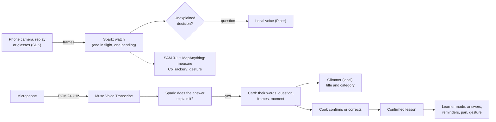

# Compinche

### From their hands to yours.

**An apprentice that watches someone cook, asks about what they didn't explain, and teaches it back to you in your own kitchen.**

Recipes leave things unsaid: “a little more”, “until it looks right”, “like that”. The knowledge is in the person: what they look at, why they turn the heat down, how they know it's ready.

Compinche watches a cook through a phone camera (or Ray-Ban Meta glasses through the Wearables SDK). When the cook makes a decision without saying why, it asks, out loud, at that moment. The cook's own words are kept as a card, tied to the question and to the moment in the video. The cook confirms or corrects the card. Later, when someone else makes the dish in another kitchen, Compinche brings that teaching back, and only that.

The demo is personal: my dad teaching me his béchamel for croquettes.

<table>
  <tr>
    <td></td>
    <td></td>
  </tr>
  <tr>
    <td align="center">Learner mode: no reference of known size is visible, so Compinche asks.</td>
    <td align="center">It compares the learner's pan with the pot from the lesson.</td>
  </tr>
</table>

*Built during the Meta AI Developer Hackathon (26 Oct – 4 Nov 2026), Indie track.*

[The loop](#the-loop) · [What works today](#what-works-today) · [Meta models](#meta-models) · [Run it](#run-it) · [How it works](#how-it-works) · [Limits](#limits)

## The loop

1. **Watch.** Muse Spark looks at the latest frames while the person cooks. It follows the phases of the recipe and the heat.
2. **Ask.** When it sees a decision whose reason is missing (lowering the heat, lifting the whisk to look, covering the bowl), it asks one short question aloud and waits for a natural pause.
3. **Keep their words.** The spoken answer is transcribed by Muse Voice Transcribe. Spark checks whether it explains the question: an unrelated reply keeps the question open, and a fragmented answer is joined first. The card keeps the speaker, the question, the frames and the moment in the video. The literal words are never rewritten.
4. **Review.** The cook confirms the card, or corrects it in their own words. A correction replaces whatever had been derived from the earlier words. Muse Glimmer, running locally (Spark if it is not running), turns each explanation into a titled card in the background.
5. **Teach it back.** In learner mode, Compinche uses **only confirmed cards**:
   - It answers questions by quoting the teacher, and says so when something was not taught.
   - It gives one proactive reminder when the learner reaches the right moment.
   - It measures the learner's pan and compares it with the one in the lesson.
   - It compares the learner's gesture with the teacher's demonstration.

## What works today

Status on 3 November 2026. Every result in the demo video comes from the app.

| Part | Status |
| --- | --- |
| Live teaching session | Phone camera (Chrome) or causal replay of a recording; continuous listening; spoken questions with a local voice. Tested on 3 Nov with a person cooking live on the phone, answering by microphone: Compinche asked three questions and each answer became an unconfirmed card. On Dad's 16-minute recording it asked 12 questions. |
| Dad's teaching | **Pending.** His answers to those 12 questions are being recorded. Until they are confirmed, his lesson has no cards, and learner mode honestly answers “Dad didn't explain that”. |
| Review | Confirming and correcting cards; corrections re-derive the card; cards that are still being consolidated finish after the session ends. |
| Learner mode | Answers only from confirmed cards and cites the teacher, otherwise says it is not in the lesson; a reminder at most once per card; a learner can replay their own recording, with their recorded words treated as learner questions. Tested with test cards; still to be tested with Dad's real ones. |
| Measuring the vessel | SAM 3.1 finds the pot and a 1 L milk carton used as a scale reference, and MapAnything gives the geometry. Dad's pot: ≈31 cm, from a steep 77° side view, so with a wide range; its real diameter has not been checked yet. If the view is steep, it asks for a view from above. If no reference is visible, it asks the size (learner's pan: 28 cm). Then it compares surfaces: 82%. |
| Gesture comparison | CoTracker3 + DTW align two gestures; Spark names one visible difference; split-screen video. Tested between two moments of Dad's recording (whisk kept in the pot vs lifted to watch the batter fall). Learner vs teacher is pending. |
| Muse Glimmer (local) | Turns explanations into titled cards in the background on a GB10 (FP8, ~7.5 tokens/s, ~65 s per card). Can also answer the learner (`COMPINCHE_GLIMMER_GUIDE=1`, ~35 s); Spark does it live by default. |
| Languages | Spanish and English sessions. The prompts are not specific to croquettes; they were also tried on other recipes. |
| Ray-Ban Meta / Android | A native host built on the Wearables SDK with MockDeviceKit; the APK builds. Not yet run on a phone with glasses. |

The video script, taken from the edit and from the takes recorded with the app, is in [docs/GUION.md](docs/GUION.md) (Spanish). Measured latencies and earlier trials are in [docs/LIVE.md](docs/LIVE.md).

## Meta models

| Model | What it does in Compinche | Where it runs |
| --- | --- | --- |
| **Muse Spark 1.3** | Watches and asks, checks whether an answer explains the question, guides the learner, compares gestures | Meta Model API |
| **Muse Voice Transcribe 1.0** | Continuous speech recognition, biased with the recipe's vocabulary | Meta Model API (WebSocket) |
| **SAM 3.1** | Segments the vessel, the scale reference and the tool in use | Meta Model API |
| **Muse Glimmer 30B** | Turns explanations into cards in the background; optionally answers the learner | Local GPU (vLLM, FP8), Spark as fallback |
| **MapAnything** (Apache-2.0) | Metric geometry for measuring | Local GPU |
| **CoTracker3** | Point tracking to align gestures | Local GPU |

## Run it

Use **Python 3.12** and a recent Chrome. Node.js 18+ is only needed for the npm shortcuts. There is no frontend build step.

```bash
git clone https://github.com/DavidDiazMerino/compinche.git
cd compinche
python3 -m venv backend/.venv
backend/.venv/bin/python -m pip install -r backend/requirements.lock.txt
cp backend/.env.example backend/.env.local     # add MODEL_API_KEY
backend/.venv/bin/python -m backend.serve --env-file backend/.env.local --port 8017
```

Open **[http://127.0.0.1:8017/#teach](http://127.0.0.1:8017/#teach)**:

- **Teach:** choose the phone camera or a recording, say who is cooking, and start. Compinche watches, listens and asks. The **Glasses view** button gives a clean frame for filming.
- **Learn:** choose a lesson; only its confirmed cards are used.

Optional parts:

- **Muse Glimmer:** run `backend/glimmer/serve.sh`, then start the server with `COMPINCHE_GLIMMER_URL=http://127.0.0.1:8100/v1`.
- **Measurement and gestures:** need a local GPU runtime; see [backend/MEASURE.md](backend/MEASURE.md).
- **Local voice:** Piper; see [docs/LIVE.md](docs/LIVE.md#instalación-y-api). Without it, the browser voice is used.

**Phone camera:** browsers only allow the camera on HTTPS or `localhost`.

- Over USB: `adb reverse tcp:8017 tcp:8017` and open `http://localhost:8017/#teach` on the phone.
- From another house: put it behind Tailscale with `tailscale serve`, and add the host name to `COMPINCHE_ALLOWED_HOSTS`. The app has no accounts, so anyone in that tailnet can open it.

**Keys:** the Meta key stays in the server environment (`MODEL_API_KEY`), never in the browser. `backend.serve --env-file` loads a local file that Git ignores.

## How it works



Vision, speech, voice and the slow tools (measurement, gestures, card consolidation) run in separate queues, so a slow tool never delays a question. Vision keeps one observation in flight and one replaceable pending one, rather than queueing every late frame. Seeking, pausing or stopping invalidates stale results, and late questions say which moment they refer to. Recorded audio from a replay is context only: it can never answer a question in someone's name.

Each card separates what was **said** (the literal quote, with its audio) from what was **derived** (signal, decision, title). Only a person can confirm it.

The learner never sees unconfirmed cards. A learner answer marked as known must cite a confirmed card. Quantities that are not in the lesson are refused rather than made up.

Code: [backend/live.py](backend/live.py) (session coordinator), [backend/live_provider.py](backend/live_provider.py) (prompts and Meta adapters), [backend/measure.py](backend/measure.py), [backend/gesture.py](backend/gesture.py), [dist/live.js](dist/live.js) (live interface).

## Limits

- **The central scene is not recorded yet.** It goes: the teacher answers, confirms the cards, and those cards then help the learner. Every step works with test answers; Dad's real answers are pending.
- **Vessel diameter is an estimate with a range.** It needs a visible reference of known size (or the cook stating the size). It does not validate the recipe: the advice is geometry only.
- **Gesture comparison names one visible difference.** It does not judge doneness, texture or temperature.
- **No weights, temperatures or doneness.** Compinche does not infer them from images.
- **Latency.** In replay trials, about 4 s passed from admitting a frame window to the question starting to play; physical capture time is not included. The goal is a question that arrives while it is still natural to answer. See [docs/LIVE.md](docs/LIVE.md).
- **Local development server.** Keep it on `127.0.0.1` or inside a private network: there are no accounts or authorisation.

## Data and privacy

Family recordings and their frames stay in local storage that Git ignores (`backend/.data/`). They are not in this repository. Each live session starts with explicit consent. Frames and audio from that session are sent to the Meta Model API with `store:false`. Glimmer, MapAnything, CoTracker3 and the voice run locally.

## Built during the hackathon

All of this repository was written during the event; the commit history is the record.

| Date | What was built |
| --- | --- |
| 3 Nov | Mise en place at the start, recipe-aware questions for any recipe, English sessions, heat level and induction-aware heat cues, asking the vessel size when no reference is visible, learner replay of their own recording, clean glasses view for filming, coherent corrections and learner answers |
| 2 Nov | Card consolidation with **Muse Glimmer** on the local GPU, corrections, card categories, the HUD overlay with the SAM picture-in-picture, live segmentation through **SAM 3.1 on the Meta Model API** |
| 1 Nov | Timeline of phases and heat, gesture comparison with **CoTracker3** + DTW + Spark, vessel measurement with **SAM 3.1** + **MapAnything** and a top-view request, learner mode with reminders, answer relevance check |
| 31 Oct | Continuous live session: camera or replay, Muse Voice Transcribe streaming, spoken questions, decision cards, Android Wearables SDK host |
| 29 Oct | First prototype: mobile app, capture and import, LangGraph agent, Meta adapters, local SAM 3.1 |

The first prototype's screens (capture, import, memories and the illustrative “Mom's croquettes” example) are still in the app, under `#home`. Their documentation is in [backend/README.md](backend/README.md) and [backend/SAM.md](backend/SAM.md).

## Development

```bash
npm run check    # JavaScript syntax
npm test         # backend (pytest) and interface tests
```

The tests use controlled providers; they are separate from the live checks with Meta. [GitHub Actions](.github/workflows/ci.yml) runs them without API keys or a GPU.

## Credits and license

Application code: [MIT License](LICENSE). Models, weights and third-party assets keep their own terms.

Stock footage from Pexels (Pressmaster, Taryn Elliott, cottonbro studio); details in [credits.json](dist/assets/credits.json). DM Sans and DM Serif Display are bundled with their [font](dist/assets/DM-Sans-LICENSE.txt) [licenses](dist/assets/DM-Serif-Display-LICENSE.txt).

Built with the [Meta Model API](https://dev.meta.ai/docs/overview), [SAM 3](https://github.com/facebookresearch/sam3), [MapAnything](https://github.com/facebookresearch/map-anything), [CoTracker](https://github.com/facebookresearch/co-tracker), [FastAPI](https://fastapi.tiangolo.com/), [LangGraph](https://docs.langchain.com/oss/python/langgraph/overview) and [Piper](https://github.com/rhasspy/piper). This independent project does not imply endorsement by any of them.
